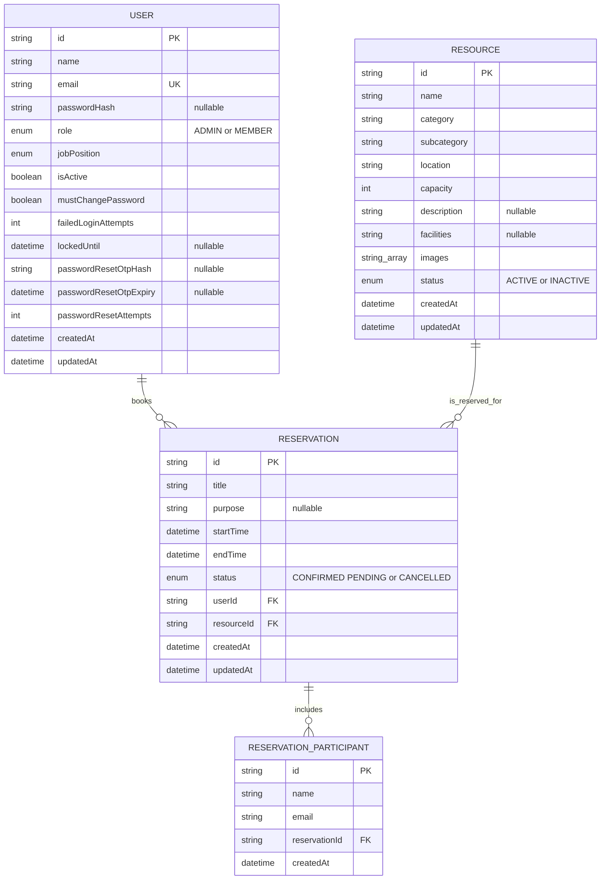

# ResourceHub ER Diagram

This diagram reflects the current Prisma schema in `prisma/schema.prisma`.

## Relationship and booking notes

- A user can create many reservations. Every reservation belongs to exactly one user.
- A resource can have many reservations. Every reservation is for exactly one resource.
- A reservation can have zero or more additional participants. The booker is represented by the `userId` relationship, not duplicated as a participant.
- Deleting a reservation cascades to its participants. Users and resources are restricted from deletion while reservations still reference them; resource removal in the application deactivates it first and only permits deletion after upcoming reservations finish.
- Both pending and confirmed reservations block overlapping time slots. Cancelled reservations do not.

The schema also indexes reservation lookups by resource and time range, and participant lookups by reservation.
